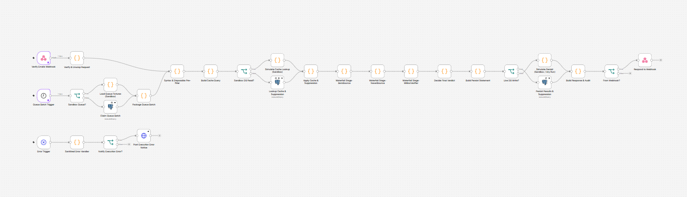
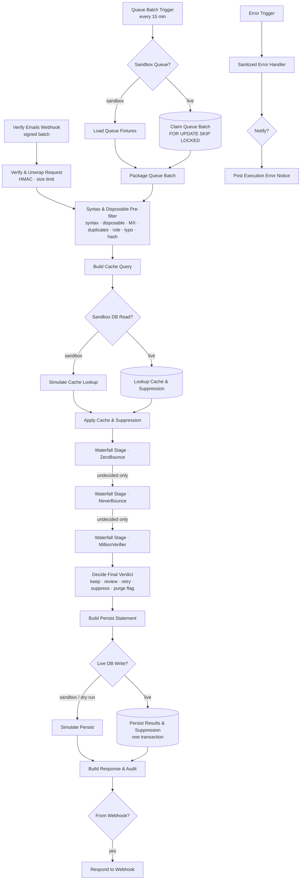

# n8n-email-verification-cascading-waterfall-engine

**Free checks first, then ZeroBounce → NeverBounce → MillionVerifier only for the emails that are still undecided — stopping at the first definitive answer — with results, a suppression list and a work queue in PostgreSQL.**

I built this n8n workflow for teams who verify a lot of addresses and pay per verification. Most addresses don't need three providers. Many don't need one: a malformed address, a disposable domain, a domain without mail servers, an address already suppressed, or one verified last week can all be answered for free. The rest go down a waterfall. Each provider is only asked about the addresses the previous one couldn't settle, usually catch-all, unknown or greylisted. Invalid mailboxes go on a suppression list and are flagged as purge candidates for a person to confirm. **Nothing is ever deleted.**

> **Safe by default.** `SANDBOX_MODE=true` and `DRY_RUN=true`. Out of the box, the workflow only uses pinned fictional addresses, provider answers and database rows. Sandbox makes no provider or database calls. Dry run calls the providers (which spends credits) and reads the database, but writes nothing.

Built by DH Robin, Revenue Infrastructure Architect · dhRobin Systems · MIT licensed.

---

## Table of Contents

1. [Why this exists](#1-why-this-exists)
2. [Architecture](#2-architecture)
3. [Repository layout](#3-repository-layout)
4. [Prerequisites](#4-prerequisites)
5. [PostgreSQL schema setup](#5-postgresql-schema-setup)
6. [Triggers: webhook & queue](#6-triggers-webhook--queue)
7. [Pre-filter, cache & suppression](#7-pre-filter-cache--suppression)
8. [The waterfall](#8-the-waterfall)
9. [Verdicts, suppression & purge candidates](#9-verdicts-suppression--purge-candidates)
10. [Environment variables](#10-environment-variables)
11. [Node configuration guide](#11-node-configuration-guide)
12. [Deployment steps & testing stages](#12-deployment-steps--testing-stages)
13. [Security & privacy model](#13-security--privacy-model)
14. [Troubleshooting](#14-troubleshooting)
15. [Known limitations](#15-known-limitations)
16. [Disclaimer & license](#16-disclaimer--license)

---

## 1. Why this exists

- **Verification credits add up.** Running every address through a premium verifier, or through two "to be safe", pays for answers you already had.
- **Providers disagree on the hard cases.** Catch-all domains and slow mail servers come back "unknown" from one provider and resolvable from another. A second opinion is worth paying for only on those cases.
- **Bad addresses come back.** Without a suppression list, the same invalid mailbox gets verified, and paid for, again on every import.
- **Deleting by script is dangerous.** A purge should be a decision a person makes, with evidence.

My answer:
- Free checks, then cache and suppression, then the cheapest path through the providers, with early exit.
- Per-provider caps, budgets and a circuit breaker.
- Every result, its provider path and its cost stored in PostgreSQL. Purges stay flags until someone confirms them.

## 2. Architecture





**The waterfall is a straight line.** Every item passes through every stage, and a stage only calls its provider for items nobody has decided yet. That's why the three stages are Code nodes using n8n's built-in HTTP helper, not branching HTTP Request nodes: n8n never has to merge branches, the webhook gets exactly one response, and each stage can apply run caps, daily budgets, concurrency and a circuit breaker across the whole batch.

| Required component | Nodes |
|---|---|
| Webhook / batch trigger | `Verify Emails Webhook`, `Verify & Unwrap Request`, `Queue Batch Trigger`, `Claim Queue Batch`, `Package Queue Batch` |
| Syntax / disposable pre-filter | `Syntax & Disposable Pre-filter` |
| Cascading verification waterfall | `Waterfall Stage · ZeroBounce` → `Waterfall Stage · NeverBounce` → `Waterfall Stage · MillionVerifier` |
| PostgreSQL state, results & suppression | `Lookup Cache & Suppression`, `Apply Cache & Suppression`, `Decide Final Verdict`, `Build Persist Statement`, `Persist Results & Suppression` |
| Sanitized audit logging | `Build Response & Audit`, `Sanitized Error Handler` |

## 3. Repository layout

```
n8n-email-verification-cascading-waterfall-engine/
├── README.md        ← this file (includes the PostgreSQL schema)
├── workflow.json    ← import into n8n (inactive, sandbox defaults, pinned fixtures)
├── DISCLAIMER.md
└── LICENSE          ← MIT
```

## 4. Prerequisites

| Item | Notes |
|---|---|
| n8n | 1.x, with `N8N_BLOCK_ENV_ACCESS_IN_NODE=false` and `NODE_FUNCTION_ALLOW_BUILTIN=crypto,dns` (`dns` only if `MX_CHECK_ENABLED=true`) |
| n8n Code-node HTTP helper | The waterfall stages call `this.helpers.httpRequest` from Code nodes. If your n8n build doesn't expose it, every stage reports `http_helper_unavailable` and the emails end as `unknown / retry`. Nothing breaks, but nothing gets verified. Check it in Stage 2. |
| PostgreSQL | 12 or newer, with the schema in section 5 and a least-privilege role |
| Providers | API keys for any of ZeroBounce, NeverBounce and MillionVerifier. Use one, two or all three; disabled or unconfigured providers are skipped. |
| Workflow settings | Settings → Error Workflow = this workflow. Concurrency: the queue claim is safe to run in parallel (`SKIP LOCKED`), but budgets live in static data, so keep concurrency at 1 if you rely on daily budgets. |

## 5. PostgreSQL schema setup

Run this once (`psql "YOUR_POSTGRES_URL" -f schema.sql`, or paste it into your SQL client):

```sql
-- n8n-email-verification-cascading-waterfall-engine · PostgreSQL schema (12+)
CREATE TABLE IF NOT EXISTS email_verification_queue (
  id            bigserial PRIMARY KEY,
  email         text        NOT NULL,
  list_id       text,
  external_ref  text,
  status        text        NOT NULL DEFAULT 'pending' CHECK (status IN ('pending', 'processing', 'done', 'failed')),
  attempts      int         NOT NULL DEFAULT 0,
  claimed_at    timestamptz,
  processed_at  timestamptz,
  final_status  text,
  action        text,
  run_id        text,
  created_at    timestamptz NOT NULL DEFAULT now()
);
CREATE INDEX IF NOT EXISTS email_verification_queue_status_idx ON email_verification_queue (status, created_at);

CREATE TABLE IF NOT EXISTS email_verification_results (
  id             bigserial PRIMARY KEY,
  run_id         text        NOT NULL,
  email_hash     char(64)    NOT NULL,
  email_domain   text        NOT NULL,
  email          text,                       -- only when STORE_EMAIL_PLAINTEXT=true
  final_status   text        NOT NULL CHECK (final_status IN ('valid', 'risky', 'unknown', 'invalid', 'disposable', 'do_not_mail', 'suppressed')),
  sub_status     text,
  confidence     smallint,
  decided_by     text,
  action         text        CHECK (action IN ('keep', 'review', 'retry', 'suppress')),
  provider_trail jsonb       NOT NULL DEFAULT '[]'::jsonb,
  credits_used   numeric(8,2) NOT NULL DEFAULT 0,
  source         text,
  verified_at    timestamptz NOT NULL DEFAULT now()
);
CREATE INDEX IF NOT EXISTS email_verification_results_hash_idx ON email_verification_results (email_hash, verified_at DESC);

CREATE TABLE IF NOT EXISTS email_suppression (
  email_hash          char(64)    PRIMARY KEY,
  email_domain        text,
  email               text,                  -- only when STORE_EMAIL_PLAINTEXT=true
  reason              text        NOT NULL,  -- hard_invalid | syntax | no_mx | disposable | spamtrap | abuse | do_not_mail | manual
  source_status       text,
  purge_candidate     boolean     NOT NULL DEFAULT false,
  first_suppressed_at timestamptz NOT NULL DEFAULT now(),
  last_seen_at        timestamptz NOT NULL DEFAULT now(),
  reviewed_by         text,
  reviewed_at         timestamptz
);

CREATE TABLE IF NOT EXISTS email_verification_runs (
  run_id      text PRIMARY KEY,
  origin      text,
  mode        text,
  started_at  timestamptz,
  finished_at timestamptz,
  received    int,
  api_calls   jsonb,
  credits     jsonb,
  outcomes    jsonb,
  early_exits jsonb
);

-- Review queue for people: purge candidates not yet confirmed
CREATE OR REPLACE VIEW email_purge_review AS
  SELECT email_hash, email_domain, email, reason, source_status, first_suppressed_at, last_seen_at
    FROM email_suppression
   WHERE purge_candidate AND reviewed_at IS NULL;

-- Least-privilege role for n8n (set the password outside version control)
-- CREATE ROLE n8n_email_verify LOGIN PASSWORD 'YOUR_POSTGRES_PASSWORD';
-- GRANT SELECT, INSERT, UPDATE ON email_verification_queue, email_verification_results, email_suppression, email_verification_runs TO n8n_email_verify;
-- GRANT USAGE ON SEQUENCE email_verification_queue_id_seq, email_verification_results_id_seq TO n8n_email_verify;
-- GRANT SELECT ON email_purge_review TO n8n_email_verify;
```

**What each table is for:**

| Table / view | Purpose |
|---|---|
| `email_verification_queue` | Your work queue. Insert rows with `status = 'pending'` to have them verified in batches. It holds the addresses you put there. |
| `email_verification_results` | One row per fresh verdict: email hash, domain, status, deciding step, provider path (`provider_trail`) and credits. It's the cache for later runs. Plaintext only with `STORE_EMAIL_PLAINTEXT=true`. |
| `email_suppression` | One row per suppressed mailbox (by hash), with the reason, `purge_candidate` and review columns. Checked before any paid call. |
| `email_verification_runs` | One summary per run: calls, credits, outcomes, and which step decided how many. |
| `email_purge_review` | View of purge candidates nobody has reviewed yet. |

**n8n credential:** create a **Postgres** credential in n8n from the parts of `YOUR_POSTGRES_URL` (host, port, database, user, password, SSL). Then select it on the three Postgres nodes, which ship with the placeholder `YOUR_POSTGRES_CREDENTIAL_ID`. To keep it out of the UI, n8n can also take credential values from `CREDENTIALS_OVERWRITE_DATA`. Connect with the least-privilege role from the end of the schema, never a superuser.

**The three statements** live in the Postgres nodes. Parameters are passed base64-encoded, so the node's comma-separated query parameters can't split JSON.
- **Claim Queue Batch:** `UPDATE … WHERE id IN (SELECT … FOR UPDATE SKIP LOCKED) RETURNING …`. Rows stuck in `processing` for 30 minutes are reclaimed.
- **Lookup Cache & Suppression:** for the batch's hashes, the latest non-unknown verdict within the TTL and any suppression row.
- **Persist Results & Suppression:** one statement with data-modifying CTEs. It inserts results, upserts suppression (`ON CONFLICT`), updates queue rows, and inserts the run summary. A replayed run doesn't insert results twice.

## 6. Triggers: webhook & queue

### 6.1 Webhook (synchronous)

`POST https://YOUR_N8N_HOST/webhook/email-waterfall/verify`

```json
{ "list_id": "spring-webinar", "emails": ["dana.whitfield@northwind-fixture.example", { "email": "info@globex-fixture.example", "ref": "crm-1008" }] }
```

**Signing:**
- `X-Timestamp: <unix seconds>`
- `X-Signature: sha256=<hex HMAC-SHA256(VERIFY_WEBHOOK_SECRET, X-Timestamp + "." + raw body)>`
- Outside sandbox, timestamps older than `SIGNATURE_TOLERANCE_SECONDS` (300) are rejected.
- Up to `MAX_EMAILS_PER_REQUEST` (500) addresses per request.

The response comes from **Respond to Webhook** once the waterfall finishes:

```json
{
  "ok": true, "runId": "ev_…", "mode": "live",
  "summary": { "received": 14, "byStatus": { "valid": 5, "invalid": 4, "risky": 2 }, "byAction": { "keep": 5, "review": 2, "suppress": 7 }, "totalCredits": 9, "callsAvoided": 6 },
  "results": [
    { "email": "dana.whitfield@northwind-fixture.example", "ref": null, "emailRef": "em-…", "status": "valid", "subStatus": null, "action": "keep",
      "purgeCandidate": false, "decidedBy": "zerobounce", "confidence": 95, "didYouMean": null, "flags": [] }
  ]
}
```

Rejected requests get 401, 400 or 413 with `{ "ok": false, "error": "…" }`. Set `RESPONSE_INCLUDE_EMAIL=false` to return only `emailRef` and your `ref`. For large lists, use the queue: each provider call takes up to a few seconds.

### 6.2 Queue (asynchronous)

Insert rows into `email_verification_queue`. Every 15 minutes, **Queue Batch Trigger** claims up to `QUEUE_BATCH_SIZE` (200) and verifies them. It writes `final_status`, `action` and `status`: `done`, back to `pending` for unknowns while `attempts < QUEUE_MAX_ATTEMPTS` (3), or `failed`.

## 7. Pre-filter, cache & suppression

Answered for free, before any paid call:

| Check | Result |
|---|---|
| Syntax: practical RFC rules (one `@`, local part ≤ 64 characters, valid labels, alphabetic TLD, total ≤ 254) | `invalid / syntax` |
| Disposable domain: 20 well-known services built in, plus `DISPOSABLE_DOMAINS` | `disposable / disposable_domain` |
| MX lookup (`MX_CHECK_ENABLED=true`): no MX and no A record | `invalid / no_mx` |
| On `email_suppression` | `suppressed` (reason kept) |
| Verified within `CACHE_TTL_DAYS` (30), or `RISKY_CACHE_TTL_DAYS` (7) for risky | the stored verdict, `decidedBy: cache:<provider>` |
| Same address twice in a batch (case-insensitive) | verified once, copied to the duplicate |

**Flags** (no decision, the providers still check):
- `role_address` for info@, sales@, support@ and the like. Set `ROLE_ADDRESS_POLICY=risky` to skip providers for them.
- `possible_typo` with `didYouMean` for common domain typos (gmial → gmail, hotmial → hotmail, …). Add your own pairs with `DOMAIN_TYPO_MAP`.
- `free_mailbox`, reported by providers.

Every address gets `email_hash = sha256(EMAIL_HASH_PEPPER + lowercase(email))`. The hash is the key for the cache, the suppression list and the audit. Set the pepper once and keep it secret: changing it empties the cache and the suppression matching.

## 8. The waterfall

Each stage calls its provider only for addresses still undecided, `PROVIDER_CONCURRENCY` (3) at a time:

| Stage | Request | Definitive → stop | Passes on |
|---|---|---|---|
| **ZeroBounce** | `GET {ZEROBOUNCE_API_BASE_URL}/v2/validate?api_key=…&email=…` | `valid`, `invalid`, `spamtrap`/`abuse`/`do_not_mail` → do_not_mail, `do_not_mail/disposable` → disposable, `do_not_mail/role_based` → risky | `catch-all`, `unknown` (greylisted, server did not respond, …) |
| **NeverBounce** | `GET {NEVERBOUNCE_API_BASE_URL}/v4/single/check?key=…&email=…&timeout=…` | `valid`, `invalid`, `disposable` | `catchall`, `unknown` |
| **MillionVerifier** | `GET {MILLIONVERIFIER_API_BASE_URL}/api/v3/?api=…&email=…&timeout=…` | `ok` → valid, `invalid`, `disposable` | `catch_all`, `unknown`, `error` |

`EARLY_EXIT_STATUSES` (default `valid,invalid,disposable,do_not_mail,risky`) controls which results stop the cascade. Remove `risky` to send role-based addresses on to the next provider.

**Cost controls, per provider:**
- **`<PROVIDER>_ENABLED`:** turn a stage off. A stage without an API key is skipped automatically.
- **`<PROVIDER>_MAX_CALLS_PER_RUN`** (500): calls beyond this are skipped (`run_cap_reached`).
- **`<PROVIDER>_DAILY_CREDIT_BUDGET`** (0 = unlimited): a daily call budget kept in static data, outside sandbox (`daily_budget_reached`). Failed calls don't count against it.
- **Circuit breaker:**
  - **Trips immediately** on auth failures and exhausted credits (HTTP 401/402/403, or the provider's error body).
  - **Trips after errors** once there are `CIRCUIT_BREAK_AFTER_ERRORS` (3) consecutive network or 5xx errors.
  - **When open,** the rest of the batch skips that provider and moves on to the next one.
  - **HTTP 429** counts as a plain error, not a reason to trip on its own.
- **Credit estimate:** recorded per call. Unknown results (all providers) and MillionVerifier catch-all are counted as free. Check this against your plan.

## 9. Verdicts, suppression & purge candidates

| Final status | When | Action | Suppression reason | Purge candidate |
|---|---|---|---|---|
| `valid` | a provider said valid / ok | `keep` | — | no |
| `risky` | catch-all after the waterfall, or role-based | `review` (`RISKY_ACTION=keep` to keep) | — | no |
| `unknown` | nobody could decide (or every provider skipped or failed) | `retry` | — | no |
| `invalid` | syntax, no MX, or a provider said invalid | `suppress` | `syntax`, `no_mx`, `hard_invalid` | **yes** |
| `disposable` | disposable domain or provider | `suppress` (`DISPOSABLE_ACTION=review`) | `disposable` | no |
| `do_not_mail` | spamtrap, abuse, toxic, global suppression | `suppress` | `spamtrap`, `abuse`, `do_not_mail` | **yes** |
| `suppressed` | already on the list | `suppress` | (existing) | (existing) |

`PURGE_CANDIDATE_STATUSES` (default `invalid,do_not_mail`) decides which statuses are flagged. **The workflow never deletes anything.** To act on purge candidates:

```sql
-- Review
SELECT * FROM email_purge_review ORDER BY last_seen_at DESC;
-- Confirm after checking (then remove the contacts in your CRM / ESP yourself)
UPDATE email_suppression SET reviewed_by = 'your.name', reviewed_at = now() WHERE email_hash = '…';
```

## 10. Environment variables

Copy this block into your n8n environment and replace every placeholder.

```bash
# ── Safety switches ──
SANDBOX_MODE=true
DRY_RUN=true

# ── Webhook ──
VERIFY_WEBHOOK_SECRET=YOUR_VERIFY_WEBHOOK_SECRET
SIGNATURE_TOLERANCE_SECONDS=300
MAX_EMAILS_PER_REQUEST=500
RESPONSE_INCLUDE_EMAIL=true

# ── PostgreSQL (used to fill the n8n Postgres credential; see section 5) ──
POSTGRES_URL=YOUR_POSTGRES_URL
QUEUE_BATCH_SIZE=200
QUEUE_MAX_ATTEMPTS=3
STORE_EMAIL_PLAINTEXT=false
EMAIL_HASH_PEPPER=YOUR_RANDOM_PEPPER

# ── ZeroBounce ──
ZEROBOUNCE_API_KEY=YOUR_ZEROBOUNCE_API_KEY
ZEROBOUNCE_API_BASE_URL=https://api.zerobounce.net
ZEROBOUNCE_ENABLED=true
ZEROBOUNCE_MAX_CALLS_PER_RUN=500
ZEROBOUNCE_DAILY_CREDIT_BUDGET=0
ZEROBOUNCE_TIMEOUT_SECONDS=15

# ── NeverBounce ──
NEVERBOUNCE_API_KEY=YOUR_NEVERBOUNCE_API_KEY
NEVERBOUNCE_API_BASE_URL=https://api.neverbounce.com
NEVERBOUNCE_ENABLED=true
NEVERBOUNCE_MAX_CALLS_PER_RUN=500
NEVERBOUNCE_DAILY_CREDIT_BUDGET=0
NEVERBOUNCE_TIMEOUT_SECONDS=20

# ── MillionVerifier ──
MILLIONVERIFIER_API_KEY=YOUR_MILLIONVERIFIER_API_KEY
MILLIONVERIFIER_API_BASE_URL=https://api.millionverifier.com
MILLIONVERIFIER_ENABLED=true
MILLIONVERIFIER_MAX_CALLS_PER_RUN=500
MILLIONVERIFIER_DAILY_CREDIT_BUDGET=0
MILLIONVERIFIER_TIMEOUT_SECONDS=15

# ── Waterfall behaviour ──
PROVIDER_CONCURRENCY=3
CIRCUIT_BREAK_AFTER_ERRORS=3
EARLY_EXIT_STATUSES=valid,invalid,disposable,do_not_mail,risky

# ── Pre-filter & cache ──
DISPOSABLE_DOMAINS=
ROLE_ADDRESS_POLICY=verify
DOMAIN_TYPO_MAP=
MX_CHECK_ENABLED=false
MX_TIMEOUT_MS=3000
CACHE_TTL_DAYS=30
RISKY_CACHE_TTL_DAYS=7

# ── Verdicts ──
RISKY_ACTION=review
DISPOSABLE_ACTION=suppress
PURGE_CANDIDATE_STATUSES=invalid,do_not_mail

# ── Error notices (optional) ──
SLACK_WEBHOOK_URL=YOUR_SLACK_WEBHOOK_URL
SLACK_NOTIFY_ON_MONITOR_ERROR=true

# ── Audit ──
AUDIT_LOG_TO_STDOUT=true
AUDIT_RING_BUFFER_SIZE=200

# ── n8n platform ──
N8N_BLOCK_ENV_ACCESS_IN_NODE=false
NODE_FUNCTION_ALLOW_BUILTIN=crypto,dns
```

Flags accept only `true/1/yes/on` or `false/0/no/off`. Anything else keeps the safe default. Keep comments on their own lines. ZeroBounce also has regional hosts (`https://api-us.zerobounce.net`, `https://api-eu.zerobounce.net`) if your account requires one.

## 11. Node configuration guide

| Node | Type | Key settings |
|---|---|---|
| Verify Emails Webhook | Webhook v2 | POST `email-waterfall/verify` · **Respond: Using 'Respond to Webhook' node** · **Raw Body on** |
| Queue Batch Trigger | Schedule Trigger v1.2 | every 15 minutes |
| Claim Queue Batch / Lookup Cache & Suppression / Persist Results & Suppression | Postgres v2.5, Execute Query | credential `YOUR_POSTGRES_CREDENTIAL_ID` · **Always Output Data on** · continue on error · lookup retries 3×, claim and persist don't |
| Syntax & Disposable Pre-filter | Code v2, all items | section 7 |
| Apply Cache & Suppression | Code v2, all items | per-status TTL |
| Waterfall Stage · ZeroBounce / NeverBounce / MillionVerifier | Code v2, all items | `this.helpers.httpRequest` · caps, budgets, circuit breaker · section 8 |
| Decide Final Verdict | Code v2, all items | section 9 |
| Build Persist Statement | Code v2, all items | one base64 payload for the transaction |
| Build Response & Audit | Code v2, all items | response body · sanitized audit · `emailWaterfallAudit` ring buffer (not in sandbox) |
| Respond to Webhook | Respond to Webhook v1.1 | JSON body · status from `httpCode` |
| Error Trigger → Sanitized Error Handler | Error Trigger v1 + Code v2 | redacted summary, optional Slack notice |

## 12. Deployment steps & testing stages

### Deployment steps

1. Create a **staging** database and run the schema (section 5). Create the least-privilege role.
2. In n8n, go to **Workflows → Import from File** and select `workflow.json`. It imports **inactive**.
3. Create the Postgres credential and select it on the three Postgres nodes.
4. Set the environment variables (section 10) and restart n8n.
5. Set **Settings → Error Workflow** to this workflow.
6. Run the stages below, then point your forms or import jobs at the webhook or the queue, and activate the workflow.

### Stage 1 · Sandbox (pinned fixtures, no network)

`SANDBOX_MODE=true`, `DRY_RUN=true`. Execute **Verify Emails Webhook** (one signed batch of 14 fictional addresses) and **Queue Batch Trigger** (4 queued rows).

**Webhook batch:** 6 of 14 answered without an API call. ZeroBounce got 8 calls, NeverBounce 3, MillionVerifier 2, for an estimated 9 credits.

| Address (fictional) | Path | Verdict |
|---|---|---|
| dana.whitfield@northwind-fixture.example | ZeroBounce valid | **valid · keep** (1 call) |
| lee.park@northwind-fixture.example | ZB catch-all → NB catchall → MV catch_all | **risky · review** (3 calls) |
| old.employee@contoso-fixture.example | ZB invalid / mailbox_not_found | **invalid · suppress · purge candidate** |
| jordan.lee@contoso-fixture.example | ZB unknown (greylisted) → NB valid | **valid · keep** |
| sam@harbor-fixture.example | ZB unknown → NB unknown → MV invalid | **invalid · suppress · purge candidate** |
| not-an-email@@harbor-fixture.example | pre-filter | **invalid / syntax** (no call) |
| promo.signup@throwaway-fixture.example | pre-filter | **disposable** (no call) |
| info@globex-fixture.example | ZB do_not_mail / role_based | **risky · review**, role flag |
| Dana.Whitfield@Northwind-Fixture.example | duplicate | copies the first verdict (no call) |
| already.suppressed@initrode-fixture.example | suppression list | **suppressed** (no call) |
| cached.valid@umbrella-fixture.example | cache (5 days old) | **valid** (no call) |
| trap@initrode-fixture.example | ZB spamtrap | **do_not_mail · suppress · purge candidate** |
| nobody@nomail-fixture.example | MX check | **invalid / no_mx** (no call) |
| casey.morgan@gmial-fixture.example | ZB valid | **valid**, `didYouMean` casey.morgan@gmail-fixture.example (fixture typo map) |

**Queue batch:**
- ZeroBounce returns "out of credits" on the second row, so **its circuit opens**: later rows skip it and NeverBounce answers.
- MillionVerifier's credit error opens its circuit too. The last row ends **risky** on NeverBounce's catch-all.
- Queue rows are updated to `done`.

All addresses, domains (`*.example`), IDs, keys and provider responses are fictional. The SQL statements were also tested against a scratch PostgreSQL 16 database, including a replayed run.

### Stage 2 · Shadow (test keys + staging database, no writes)

`SANDBOX_MODE=false`, `DRY_RUN=true`. Use test or low-balance keys. Send 10–20 known addresses (your own test mailboxes).
- Confirm each stage reports calls, not `http_helper_unavailable`.
- Confirm cache and suppression reads work.

Providers are called in this stage, so credits are spent.

### Stage 3 · Live on staging

`DRY_RUN=false`. Confirm:
- rows land in all four tables;
- a second run of the same batch is answered from the cache;
- suppressed addresses never reach a provider;
- `email_purge_review` lists only what you expect.

### Stage 4 · Production

Switch to the production database and keys, set daily budgets, and review purge candidates on a schedule.

## 13. Security & privacy model

- **No secrets in the workflow.**
  - Provider keys and the webhook secret come from `$env`.
  - The database password lives in the n8n credential, never in the workflow JSON.
  - The JSON holds placeholders and one fictional sandbox signing secret, used only while `SANDBOX_MODE=true`.
- **API keys in query strings.** All three providers take the key as a query parameter, so those URLs are redacted everywhere: `api_key=`, `key=` and `api=` values, plus the password part of any `postgres://` connection string and every known secret value.
- **Hash first.**
  - Results, suppression and audit use the peppered SHA-256 hash.
  - Plaintext addresses are kept only in your queue table, in memory during the run, and in the webhook response to the caller who sent them.
  - Plaintext is stored in results or suppression only with `STORE_EMAIL_PLAINTEXT=true`.
- **Sanitized audit.** One record per run, with hashed refs (`em-…`), statuses, the deciding step, the provider path, credits and persistence counters. No addresses, domains or keys.
- **Fails closed.** Every webhook request needs a valid HMAC and a fresh timestamp.
- **No deletion.** Suppression and purge flags never remove data. A person confirms purges in your own systems.
- **Restrict n8n execution data.** Executions contain the submitted addresses. Limit access and set a short retention period.

## 14. Troubleshooting

| Symptom | Likely cause | Fix |
|---|---|---|
| Every result `unknown / retry`, reason `http_helper_unavailable` | Your n8n build doesn't expose `this.helpers.httpRequest` in Code nodes | Upgrade n8n, or check the task-runner settings in your n8n version's Code node docs |
| Reason `not_configured` for a provider | Missing or placeholder API key | Set `<PROVIDER>_API_KEY` |
| A provider's circuit opens immediately | Bad key or no credits | Check the account; the audit shows `auth_failed` / `out_of_credits` |
| `signature_mismatch` | Wrong secret, or the body was re-serialised | Keep **Raw Body** on; sign `timestamp + "." + raw body` |
| Webhook times out | Batch too large for a synchronous call | Use the queue, or lower `MAX_EMAILS_PER_REQUEST` |
| `relation "email_verification_results" does not exist` | Schema not created, or wrong database | Run the schema; check the credential's database |
| Postgres "permission denied" | Role lacks grants | Apply the grants at the end of the schema |
| Cache never hits | Pepper changed, or TTL too short | Keep `EMAIL_HASH_PEPPER` stable; raise `CACHE_TTL_DAYS` |
| Queue rows stuck in `processing` | Execution crashed mid-run | They're reclaimed after 30 minutes automatically |
| MX check does nothing | `dns` not allowed | `NODE_FUNCTION_ALLOW_BUILTIN=crypto,dns` |

## 15. Known limitations

- **Verification is probabilistic.** Catch-all domains can't be fully verified by any provider, so they end as `risky / review` by design.
- **Credit counts are estimates.** Providers bill differently (some don't charge for unknown or catch-all results). Reconcile with their dashboards.
- **Synchronous webhook.** Large batches belong in the queue.
- **Role and disposable lists are small.** Extend `DISPOSABLE_DOMAINS` for your traffic.
- **Daily budgets live in static data.** Keep concurrency at 1 when you rely on them.

---

## 16. Disclaimer & license

### ⚠️ Disclaimer & Liability Limitation

Use at your own risk. The code, workflows, and scripts in this repository (n8n-email-verification-cascading-waterfall-engine) are provided for educational and architectural demonstration purposes.

* **No Liability:** The author and dhRobin Systems accept no responsibility or liability for any direct, indirect, incidental, or consequential damages that result from using, misusing, or deploying these scripts.
* **No Warranty:** All software, n8n JSON blueprints, JavaScript modules and prompts are provided "AS IS", without warranty of any kind, express or implied. This includes, but is not limited to, warranties of merchantability, fitness for a particular purpose, and non-infringement.
* **Production Testing Required:** Always test thoroughly in an isolated staging environment, such as a staging PostgreSQL database and test API keys, with `SANDBOX_MODE=true` and `DRY_RUN=true` enabled, before you connect live verification provider credentials or production databases. Treat every suppression or purge flag as a draft that a person must verify before permanently deleting records.
* **Third-Party APIs & Compliance:** You alone are responsible for complying with the terms of service, rate limits, data privacy regulations (GDPR/CCPA), and security policies of ZeroBounce, NeverBounce, MillionVerifier, PostgreSQL and any connected services. That includes confirming a lawful basis for validating contact email addresses, securing database credentials, and reviewing every automatically updated or suppressed record.

The full disclaimer is also available in [DISCLAIMER.md](https://github.com/dhrobinsystems/n8n-email-verification-cascading-waterfall-engine/blob/main/DISCLAIMER.md).

### License

Released under the MIT License. Copyright (c) 2026 DH Robin (dhRobin Systems). See [LICENSE](https://github.com/dhrobinsystems/n8n-email-verification-cascading-waterfall-engine/blob/main/LICENSE).

---

Full text: DISCLAIMER.md · Licensed under the MIT License. License: MIT © 2026 DH Robin (dhRobin Systems) · Provided as-is, see the disclaimer.
